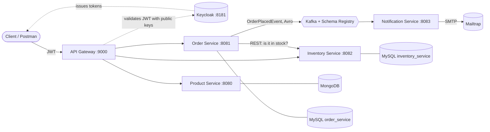

# Spring Boot 3 Microservices: E-commerce Order Platform

A small e-commerce backend built as five Spring Boot 3 / Java 21 services. It covers the patterns used in real microservice systems: an API gateway, OAuth2 security, synchronous REST plus asynchronous Kafka messaging, resilience (circuit breaker, retry, timeouts), database-per-service, schema-managed events, and full observability (metrics, logs, traces).

> **Learning project.** The [`docs/`](docs/) folder explains every concept used here, the problems found in an audit and how they were fixed, and the known gaps that remain. Start with [docs/README.md](docs/README.md).

## Architecture



| Service | Port | Storage | Responsibility |
|---|---|---|---|
| api-gateway | 9000 | - | Single entry point: routing, JWT validation, CORS, circuit breakers, aggregated Swagger UI |
| my-product-service | 8080 | MongoDB | Product catalogue |
| my-order-service | 8081 | MySQL (3307) | Places orders: checks stock over REST, saves the order, publishes an event to Kafka |
| my-inventory-service | 8082 | MySQL (3308) | Stock levels; schema managed by Flyway |
| notification-service | 8083 | - | Consumes `order-placed` events and emails the customer |

Tech: Java 21, Spring Boot 3.4, Spring Cloud Gateway (MVC), Spring Security OAuth2 Resource Server, Keycloak, Resilience4j, Apache Kafka, Avro + Confluent Schema Registry, MySQL, MongoDB, Flyway, Micrometer, Prometheus, Grafana, Loki, Tempo, Testcontainers, WireMock, RestAssured.

## Running locally

**Prerequisites:** JDK 21, Docker Desktop (Compose v2.20+). Maven is provided by `./mvnw` in each service.

1. **Start all infrastructure** from the repo root:
   ```sh
   docker compose up -d
   ```
   > If you previously started the per-service compose files, run `docker compose down` in each of those folders first, otherwise the container names clash. Your data is kept (it lives in bind-mounted folders).

2. **Create your local `.env`** (git-ignored) and fill in the Mailtrap SMTP credentials from your Mailtrap inbox (*SMTP Settings*):
   ```sh
   cp .env.example .env      # then edit MAIL_USERNAME and MAIL_PASSWORD
   ```
   Every service loads `.env` automatically (`spring.config.import`), and Docker Compose reads it too. Everything else has a working local default; see the comments in [.env.example](.env.example).

3. **Start each service** (from its folder, or run the `*Application` class in your IDE):
   ```sh
   ./mvnw spring-boot:run
   ```

4. **Get an access token.** Keycloak imports the realm `spring-microservices-shoaib` with a client called `api-gateway-client` on first start. Open http://localhost:8181 (admin / admin), go to *Clients > api-gateway-client > Credentials* and copy the secret, then:
   ```sh
   curl -X POST http://localhost:8181/realms/spring-microservices-shoaib/protocol/openid-connect/token \
     -d grant_type=client_credentials -d client_id=api-gateway-client -d client_secret=<secret>
   ```
   Send `Authorization: Bearer <access_token>` with every call to the gateway.

### Useful URLs

| What | URL |
|---|---|
| Swagger UI (all services, through the gateway) | http://localhost:9000/swagger-ui.html |
| Gateway health (circuit breaker state when you send a token) | http://localhost:9000/actuator/health |
| Keycloak admin | http://localhost:8181 |
| Kafka UI | http://localhost:8086 |
| Schema Registry | http://localhost:8085/subjects |
| Grafana (metrics, logs, traces) | http://localhost:3000 |
| Prometheus | http://localhost:9090 |

## API (through the gateway, port 9000)

### Place an order: `POST /api/order`
```json
{
  "skuCode": "iphone_15",
  "price": 43000,
  "quantity": 3,
  "userDetails": { "email": "customer@example.com", "firstName": "Jane", "lastName": "Doe" }
}
```
| Status | Meaning |
|---|---|
| 201 | Created. Body: `{ "orderNumber", "skuCode", "totalPrice", "quantity" }` |
| 400 | Invalid body. Problem Details JSON with an `errors` map per field |
| 409 | Not enough stock |
| 503 | Inventory service unavailable (after retries / circuit breaker open) |

### Products
- `POST /api/product` with body `{ "name": "iphone 18", "description": "Apple 256 GB", "price": 75000 }`
- `GET /api/product`

### Inventory
- `GET /api/inventory?skuCode=iphone_15&quantity=100` returns `true` or `false`
- `POST /api/inventory` with body `{ "skuCode": "macbook_pro", "quantity": 50 }` adds stock (creates the SKU if it's new)

Errors use [RFC 9457 Problem Details](https://www.rfc-editor.org/rfc/rfc9457) (`application/problem+json`).

## Testing

```sh
mvn verify          # from the repo root: builds and tests every service (Docker must be running)
```
Integration tests start real MySQL, MongoDB and Kafka containers with Testcontainers. WireMock stands in for inventory-service, and an in-memory Schema Registry (`mock://`) stands in for Confluent's. See [docs/concepts/07-testing.md](docs/concepts/07-testing.md).

## Screenshots

Kafka UI showing the order events:


Docker containers for the project:


Order confirmation email in Mailtrap:


## Documentation

| Doc | What's in it |
|---|---|
| [docs/README.md](docs/README.md) | Where to start and a suggested reading order |
| [docs/ARCHITECTURE.md](docs/ARCHITECTURE.md) | Components, and the full path of one order through the system |
| [docs/AUDIT.md](docs/AUDIT.md) | Every problem found, why it mattered, how it was fixed |
| [docs/concepts/](docs/concepts/) | One guide per topic (gateway, security, resilience, Kafka, data, observability, testing), each with interview Q&A |
| [docs/ROADMAP.md](docs/ROADMAP.md) | Known gaps and the plan to close them |
| [docs/INTERVIEW-GUIDE.md](docs/INTERVIEW-GUIDE.md) | How to present this project: the 2-minute pitch and STAR stories |
