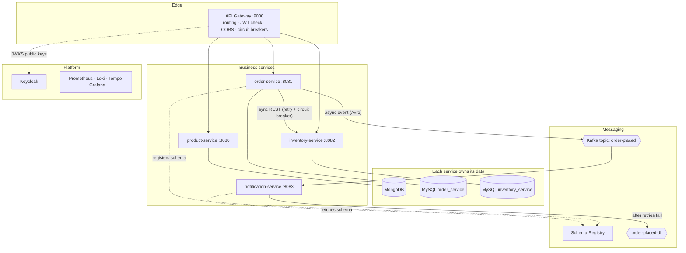
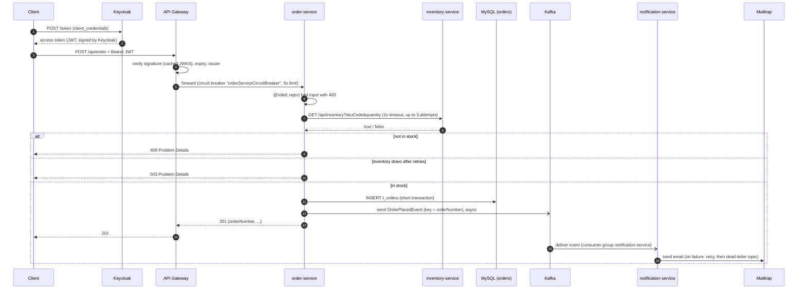

# Architecture

## The system in one paragraph

A customer-facing **API Gateway** is the only public entry point. It checks every request for a valid **JWT** from **Keycloak**, then routes it to one of three business services: **product** (catalogue, MongoDB), **order** (MySQL) and **inventory** (stock, MySQL). Placing an order involves two styles of communication. Order-service asks inventory-service *synchronously* over REST whether the item is in stock, because it needs the answer before it can accept the order. After saving the order, it publishes an `OrderPlacedEvent` to **Kafka** *asynchronously*, and **notification-service** consumes it and emails the customer. Every service exports metrics, logs and traces to the **Grafana stack**.



## Life of one order



Things to notice (and to say in an interview):

- **Steps 4-5:** the gateway checks the token by itself with Keycloak's *public* keys. It doesn't call Keycloak for every request. That is what makes JWTs scale.
- **Step 7:** this call is synchronous because the answer decides whether the order is accepted. It is the riskiest step: if inventory is slow, order is slow. That's why it has a timeout, retry and circuit breaker ([resilience](concepts/03-resilience.md)).
- **Step 11:** the event is sent *after* the response is decided and is not part of the DB transaction. The email being slow, or the mail server being down, can never fail an order. The price is the [dual-write problem](concepts/05-data-and-transactions.md#the-dual-write-problem).
- **Step 13 runs at a different time:** notification-service may be down when the order is placed. Kafka keeps the event until the service comes back. That is **temporal decoupling**.

## Why these choices

| Decision | Why | Trade-off |
|---|---|---|
| Database per service | Each service can change its schema and scale on its own; no hidden coupling through shared tables. | No cross-service JOINs or transactions; consistency has to be eventual (sagas, events). |
| MongoDB for products, MySQL for orders/inventory | Product attributes vary a lot (documents fit); orders and stock need transactions and constraints. | Two database technologies to operate. |
| REST for the stock check | The caller needs the answer immediately. | Temporal coupling: inventory must be up for orders to work. |
| Kafka for notifications | Fire-and-forget, can be replayed, and more consumers (analytics, shipping) can be added without changing order-service. | Eventual consistency; at-least-once delivery means duplicates are possible. |
| Avro + Schema Registry | Compact binary format and an enforced contract between producer and consumer; schemas can evolve safely. | More infrastructure, and the schema must be shared. |
| Gateway (Spring Cloud Gateway MVC) | One place for authentication, CORS, routing and circuit breaking; clients see one host. | A single point of failure, so it must be stateless and scaled horizontally. |

## Code layout (same in every service)

```
controller/   HTTP layer: request mapping, @Valid, status codes. No business logic.
service/      Business logic and transaction boundaries.
repository/   Spring Data interfaces: queries are generated from method names or @Query.
model/        JPA entities / Mongo documents. Never exposed directly over HTTP (see SEC-3).
dto/          Request/response records: the public API contract.
client/       Outgoing HTTP clients (order-service only).
config/       Spring @Configuration: beans, security, Kafka, OpenAPI, observability.
exception/    Domain exceptions + @RestControllerAdvice mapping them to HTTP responses.
```

## Ports

| Port | What |
|---|---|
| 9000 | API Gateway |
| 8080 / 8081 / 8082 / 8083 | product / order / inventory / notification |
| 8181 | Keycloak |
| 3307 / 3308 | MySQL for order / inventory |
| 27017 | MongoDB |
| 9092 | Kafka (from the host) · 29092 (from containers) |
| 8085 / 8086 | Schema Registry / Kafka UI |
| 3000 / 9090 / 3100 / 3200 / 9411 | Grafana / Prometheus / Loki / Tempo API / Zipkin receiver |
