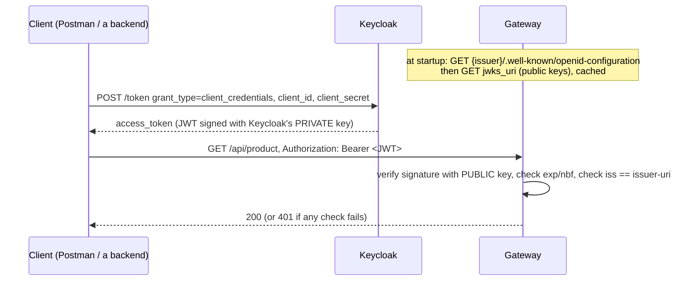

# 2. Security: OAuth2, JWT and Keycloak

## The idea in plain words

- **Authentication** = *who are you?* **Authorization** = *what may you do?*
- **OAuth2** is a standard for getting **access tokens**. An *Authorization Server* (here **Keycloak**) issues them; a *Resource Server* (here the **API gateway**) accepts them.
- **OpenID Connect (OIDC)** adds identity on top of OAuth2 (ID tokens, `/userinfo`, the discovery document).
- A **JWT** (JSON Web Token) is a signed token: `header.payload.signature`, each part Base64URL-encoded. The payload contains *claims* (`iss` issuer, `sub` subject, `exp` expiry, `aud` audience, roles...). It is **signed, not encrypted**: anyone can read it, but nobody can change it without breaking the signature.

## Where it lives

| File | What it does |
|---|---|
| [SecurityConfig.java](../../api-gateway/src/main/java/com/sh/api_gateway/config/SecurityConfig.java) | Every request needs a valid JWT except a short public list |
| `spring.security.oauth2.resourceserver.jwt.issuer-uri` in [application.properties](../../api-gateway/src/main/resources/application.properties) | Which Keycloak realm to trust |
| [realm-export.json](../../api-gateway/docker/keycloak/realms/realm-export.json) | The realm and client, imported when Keycloak starts |
| [docker-compose.yml](../../api-gateway/docker-compose.yml) | Keycloak + its MySQL |

## How it works here

1. **Client Credentials grant**: a machine-to-machine flow. The client authenticates with its own id and secret; no user is involved. For a user logging in through a browser you'd use **Authorization Code + PKCE** instead.
2. **The gateway never calls Keycloak per request.** It downloads Keycloak's public keys (JWKS) once, caches them, and validates tokens locally. That's why JWTs scale. The flip side is that a JWT **can't be revoked** before it expires, so keep access tokens short-lived (5 minutes here: `accessTokenLifespan: 300`).
3. Spring Boot does all of this from one property (`issuer-uri`) plus `oauth2ResourceServer(jwt())`.

**Public endpoints** (`permitAll`): Swagger UI/docs, `/actuator/health` (details only with a token), `/actuator/prometheus`. Everything else needs a token.

## OWASP API Security Top 10 (2023): where this project stands

| Risk | Status here |
|---|---|
| API1 Broken Object Level Authorization | No per-user data yet. Any client could read any order once order lookup exists. **Gap.** |
| API2 Broken Authentication | JWT validated at the gateway ✔. Services behind it don't validate tokens, so they can be bypassed ([ROADMAP](../ROADMAP.md)). |
| API3 Broken Object Property Level Authorization (incl. mass assignment) | **Fixed** [SEC-3](../AUDIT.md#1-security): request DTOs instead of entities. |
| API4 Unrestricted Resource Consumption | No rate limiting, and `GET /api/product` isn't paginated. **Gap.** |
| API5 Broken Function Level Authorization | No roles: any valid token can add inventory. **Gap.** (Fix: Keycloak roles → `hasRole('inventory-admin')`.) |
| API6 Unrestricted Access to Sensitive Business Flows | The order **price comes from the client**. **Gap.** |
| API8 Security Misconfiguration | **Fixed:** wildcard CORS, committed secrets, unpinned images, public health details. |
| API9 Improper Inventory Management | Swagger lists all endpoints; fine for dev, but restrict it in production. |

## Mistakes we found

[SEC-1, SEC-2](../AUDIT.md#1-security) committed secrets · [SEC-3](../AUDIT.md#1-security) mass assignment · [SEC-5](../AUDIT.md#1-security) CORS · [SEC-6](../AUDIT.md#1-security) PII in logs · [SEC-7](../AUDIT.md#1-security) a broken permit pattern · [REL-7](../AUDIT.md#2-reliability-and-correctness) Keycloak wasn't persisting anything.

**Secrets management:** a secret that has ever been pushed must be **rotated**; deleting it in a later commit isn't enough because it's still in the history. Locally: environment variables / a git-ignored `.env`. In production: a secrets manager (Vault, AWS Secrets Manager) or Kubernetes Secrets, plus secret scanning in CI (gitleaks, GitHub push protection) so it can't happen again.

## Interview questions

**Fundamentals**

1. **Authentication vs authorization?** Who you are vs what you may do. 401 Unauthorized actually means *unauthenticated*; 403 Forbidden means authenticated but not allowed.
2. **What's inside a JWT, and is it encrypted?** Header (alg, kid), payload (claims), signature. Base64URL-encoded, **not encrypted** (JWE would be): never put secrets in it.
3. **How does the resource server validate a JWT?** It picks the public key by `kid` from the cached JWKS, verifies the signature (RS256), and checks `exp`/`nbf` and `iss`. Optionally `aud` (not done here; it's a gap: without it, a token issued to *any* client in the realm is accepted).
4. **Symmetric (HS256) vs asymmetric (RS256)?** HS256 uses one shared secret, so every verifier could also *issue* tokens. RS256 uses a private key to sign and a public key to verify, so resource servers can't forge tokens. Use RS256 between services.
5. **Which OAuth2 grant when?** Authorization Code + PKCE for users (web, mobile, SPA). Client Credentials for service-to-service. Password and Implicit grants are deprecated.
6. **JWT vs opaque token + introspection?** A JWT is validated locally (fast, but can't be revoked before expiry). An opaque token needs a call to the auth server for every check (revocable, but slower). The usual compromise: short-lived JWT access tokens + refresh tokens.
7. **Why is CSRF protection not needed here?** CSRF exploits cookies that the browser sends automatically. A bearer token in the `Authorization` header isn't sent automatically, so a stateless token API can disable CSRF (Spring's resource server is configured for this).

**Scenarios**

8. **"A token was stolen. What can you do?"** It stays valid until `exp`, so short lifetimes limit the damage. Also: revoke the session or refresh token in Keycloak, rotate signing keys in an emergency (this invalidates every token), use sender-constrained tokens (DPoP / mTLS) in high-security systems.
9. **"How would services know which user placed the order?"** Forward the JWT downstream (token relay), make each service a resource server, and read `sub`/claims from `@AuthenticationPrincipal Jwt`. Then enforce object-level authorization: a user only sees their own orders.
10. **"How do you add roles?"** Define realm or client roles in Keycloak and add them to the token. Map `realm_access.roles` to Spring authorities with a `JwtAuthenticationConverter`, then `.requestMatchers(POST, "/api/inventory").hasRole("inventory-admin")` or `@PreAuthorize`.
11. **"You found a password in git history. Walk me through it."** Rotate it first (that's what stops the damage), then check the provider's logs for misuse, remove it from the code (env var / secrets manager), add secret scanning in CI, and optionally rewrite history. This happened in this repo: [AUDIT.md](../AUDIT.md#leaked-credentials).
