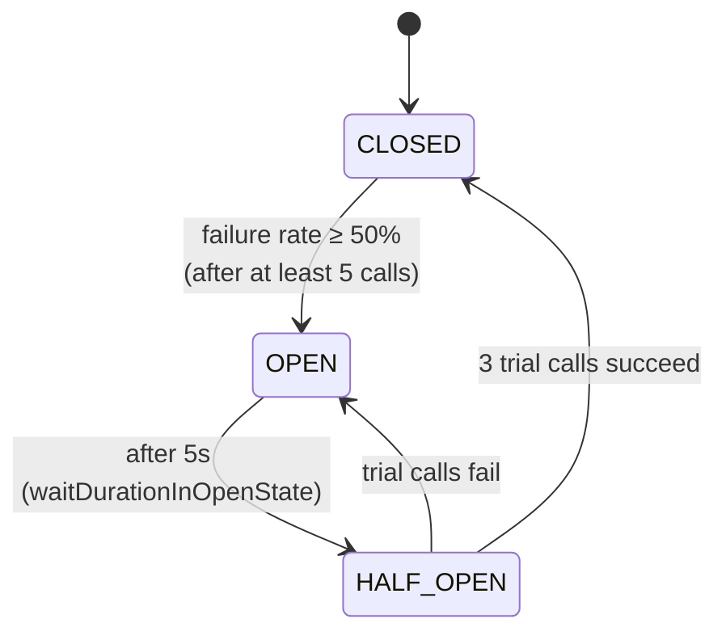

# 3. Resilience: circuit breaker, retry, timeouts

## The idea in plain words

In a distributed system, **remote calls fail**: networks drop packets, services restart, databases get slow. The goal is that one failing service doesn't take everything else down with it (a **cascading failure**). The classic cascade: inventory gets slow → order-service threads all wait on inventory → order-service runs out of threads → the gateway's calls to order-service pile up → everything is down.

Four tools, used together:

| Tool | Question it answers | Here |
|---|---|---|
| **Timeout** | "How long do I wait?" | 1s connect + 1s read for inventory calls |
| **Retry** | "Is it worth trying again?" | 3 attempts, 300ms apart, only for I/O errors and 5xx |
| **Circuit breaker** | "Should I even try, given the recent failures?" | Opens at ≥50% failures over the last 5 calls |
| **Fallback** | "What do I return instead?" | 503 with a clear message (never a fake answer) |

## Where it lives

| File | What it does |
|---|---|
| [InventoryClient.java](../../my-order-service/src/main/java/com/sh_order/microservice/order/client/InventoryClient.java) | `@CircuitBreaker` + `@Retry` + fallback on the stock check |
| [RestClientConfig.java](../../my-order-service/src/main/java/com/sh_order/microservice/order/config/RestClientConfig.java) | HTTP connect/read timeouts |
| [order application.properties](../../my-order-service/src/main/resources/application.properties) | `resilience4j.*.instances.inventory.*` |
| [Routes.java](../../api-gateway/src/main/java/com/sh/api_gateway/routes/Routes.java) + [gateway properties](../../api-gateway/src/main/resources/application.properties) | A circuit breaker per route, a 5s time limit, the fallback route |

## Circuit breaker states



- **CLOSED**: calls pass through; results are recorded in a *sliding window* (here COUNT_BASED, the last 5 calls).
- **OPEN**: calls fail **immediately** with `CallNotPermittedException`, without touching the network. This protects the failing service (gives it room to recover) and the caller (no threads stuck waiting).
- **HALF_OPEN**: a few trial calls decide whether to close again.
- `minimum-number-of-calls=5`: don't judge on too few samples (1 failure out of 1 isn't 100% broken).

## The decorator order: the bug we found

Resilience4j annotations wrap the method in a **fixed** order (outermost first):

```
Retry ( CircuitBreaker ( RateLimiter ( TimeLimiter ( Bulkhead ( yourMethod ) ) ) ) )
```

The fallback belongs to whichever annotation declares it. The original code put `fallbackMethod` on `@CircuitBreaker` (the **inner** layer):

```
Retry( CircuitBreaker( call ) → fails → fallback returns false ) → Retry sees "false", a SUCCESS → no retry
```

So **retry never happened**, and the fallback's `false` told customers "out of stock" during an outage. The fix ([REL-1, REL-2](../AUDIT.md#2-reliability-and-correctness)):

```java
@CircuitBreaker(name = "inventory")                                  // records every attempt
@Retry(name = "inventory", fallbackMethod = "fallbackMethod")        // outermost: fallback after ALL retries
boolean isInStock(...);

default boolean fallbackMethod(String sku, Integer qty, Throwable t) {
    throw new InventoryServiceUnavailableException(sku, t);          // becomes 503, not a fake "false"
}
```

The test `shouldRetryThenReturn503WhenInventoryServiceFails` makes WireMock return 500 and asserts it was called **exactly 3 times**.

## Retry: when it's safe, and when it hurts

- Only retry **idempotent** operations (repeating them has the same effect). `GET /api/inventory` is safe. Blindly retrying `POST /api/order` could create two orders, unless you use an **idempotency key**.
- Only retry **transient** errors: timeouts, connection refused, 5xx. A 400 will fail again (`retry-exceptions` lists what to retry).
- Don't retry when the breaker is open (`ignore-exceptions=CallNotPermittedException`).
- Use **exponential backoff + jitter** in production, so that 1,000 clients don't all retry at the same moment (a *retry storm* / *thundering herd*).
- Retries multiply: 3 retries at each of 3 layers = 27 calls to the bottom service. Retry at **one** layer.

## The timeout budget (REL-4)

Each layer must wait **longer** than the total worst case of everything below it:

```
order → inventory, worst case: 3 attempts × 1s read timeout + 2 × 300ms wait ≈ 3.6s
gateway time limit:            5s  > 3.6s ✔
```

Before the fix: gateway 3s, order worst case ≈ 19s. The gateway answered **503** while order-service **went on and created the order**. A client that retried after the 503 got a **duplicate order**. In a real system this calculation sits in a design doc. Some systems also propagate a *deadline* header so downstream services know how much time is left.

## Mistakes we found

[REL-1](../AUDIT.md#2-reliability-and-correctness) retry never retried · [REL-2](../AUDIT.md#2-reliability-and-correctness) fallback lied about stock · [REL-3](../AUDIT.md#2-reliability-and-correctness) GET-only gateway fallback · [REL-4](../AUDIT.md#2-reliability-and-correctness) inverted timeouts · [BLD-8](../AUDIT.md#4-build-code-quality-and-docs) a `TimeLimiter` config that never applied (TimeLimiter only works on async `CompletableFuture` methods; for a blocking call the HTTP read timeout does that job).

## Interview questions

**Fundamentals**

1. **Explain the circuit breaker states.** See the diagram above. Mention the sliding window, minimum calls, the failure-rate threshold, and the wait duration.
2. **Why not just use timeouts?** A timeout still spends the full timeout on *every* call to a dead service. An open breaker fails in microseconds and stops hammering a service that is trying to recover.
3. **Count-based vs time-based sliding window?** The last N calls vs the calls in the last N seconds. Time-based behaves better when traffic varies a lot.
4. **What's a bulkhead?** It limits concurrent calls to one dependency (a semaphore or a thread pool), so a slow inventory can only tie up, say, 10 threads, never the whole pool. Named after a ship's watertight compartments.
5. **What should a fallback return?** Something *honest*: cached data marked as stale, a default that's safe for the business, or a clear error (503). Never a fake answer that changes business outcomes (our old `false`).

**Scenarios**

6. **"Inventory is down for 2 minutes. Walk me through what happens."** First calls: 3 attempts each (~3.6s) → 503. After 5 recorded failures the breaker OPENs → instant 503s (no network calls). Every 5s it goes HALF_OPEN with 3 trial calls; once inventory is back, they succeed → CLOSED. `/actuator/health` shows the state.
7. **"Users report duplicate orders after slow responses. Why?"** Timeouts in the wrong order (REL-4) + client retries + no idempotency. Fix the budget, and add an `Idempotency-Key` header: the server stores the key with the result and returns the stored result for a repeat.
8. **"Would you retry at the gateway too?"** Not for POSTs, and generally not at several layers (retry amplification). Retry close to the failing call, with backoff.
9. **"How do you test resilience?"** WireMock faults and delays (as here), Testcontainers + Toxiproxy for network faults, and chaos engineering in staging.
