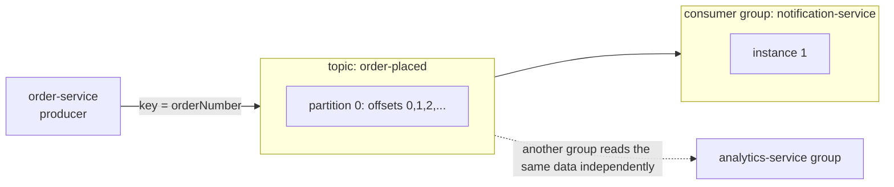
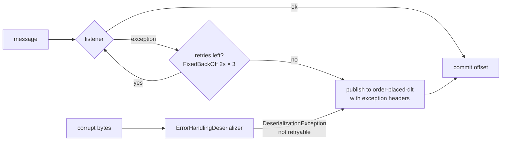

# 4. Kafka, Avro and Schema Registry

## The idea in plain words

**Kafka** is a distributed, durable, append-only **log**. Producers append messages to a **topic**; consumers read them at their own pace and remember their position (**offset**). Unlike a classic queue, messages aren't deleted when read: they're kept for a retention period, so new consumers can read history and old messages can be replayed.

We use it so order-service can say *"an order was placed"* and **not care who listens or whether they're up right now**. Today notification-service listens; tomorrow shipping and analytics can subscribe without any change to order-service. This is **loose coupling in time and in knowledge**.

**Avro** is a compact binary serialization format with a **schema**. **Schema Registry** stores the schemas and enforces compatibility rules, so a producer can't publish data that would break consumers.

## Where it lives

| File | What it does |
|---|---|
| [order-placed.avsc](../../my-order-service/src/main/resources/avro/order-placed.avsc) | The event contract. The Avro Maven plugin generates `OrderPlacedEvent.java` from it at build time |
| [OrderService.java](../../my-order-service/src/main/java/com/sh_order/microservice/order/service/OrderService.java) | `kafkaTemplate.send(topic, orderNumber, event)` with a completion callback |
| [NotificationService.java](../../notification-service/src/main/java/com/sh/microservice/notification/service/NotificationService.java) | `@KafkaListener(topics = "order-placed")` |
| [KafkaConsumerConfig.java](../../notification-service/src/main/java/com/sh/microservice/notification/config/KafkaConsumerConfig.java) | Retry with back-off + dead-letter topic |
| [order docker-compose.yml](../../my-order-service/docker-compose.yml) | ZooKeeper, broker, Schema Registry, Kafka UI |

## Core concepts

- **Topic → partitions.** A partition is an ordered log and the unit of parallelism. **Ordering is guaranteed only within a partition.**
- **Key.** The producer hashes the key to choose the partition. We use `orderNumber` as the key, so all events for one order go to the same partition, in order.
- **Consumer group.** Instances with the same `group.id` *share* the partitions (each partition goes to exactly one instance in the group). Different groups each get *all* messages. Max useful instances per group = number of partitions.
- **Offset commit.** A consumer commits "I've processed up to offset N". If it crashes before committing, the messages are delivered again, so the default is **at-least-once** delivery.
- **Rebalance.** When instances join or leave, partitions are redistributed among them.
- `auto-offset-reset=earliest`: a *new* group starts from the oldest retained message instead of only new ones.

## Delivery guarantees

| Guarantee | How | Risk |
|---|---|---|
| At-most-once | Commit before processing | Messages can be lost |
| **At-least-once** (what we have) | Commit after processing | **Duplicates**, e.g. two emails after a crash, so consumers must be **idempotent** |
| Exactly-once | Idempotent producer + Kafka transactions (`read-process-write` inside Kafka) | Only covers Kafka-to-Kafka; sending an email can never be made exactly-once |

Producer side: `acks=all` (the leader waits for all in-sync replicas) + `enable.idempotence=true` (retries don't create duplicates in the log). Both are defaults in Kafka 3.x clients; we set them explicitly so they're visible.

## Avro + Schema Registry: what happens on the wire

1. On the first send, `KafkaAvroSerializer` **registers** the schema under the subject `order-placed-value` (TopicNameStrategy) and gets back an id.
2. Each message is `[magic byte 0][4-byte schema id][Avro binary]`. There are no field names in the payload, so it's much smaller than JSON.
3. The consumer reads the id, fetches the schema (and caches it), and deserializes. With `specific.avro.reader=true` it builds the generated `OrderPlacedEvent` class instead of a `GenericRecord`.

**Schema evolution.** The registry checks every new version against a compatibility mode (default **BACKWARD**: consumers on the new schema can read data written with the old one):
- ✔ Adding a field **with a default** is backward compatible.
- ✘ Removing a field that has no default, or renaming or retyping a field, is rejected.
- Upgrade order for BACKWARD: **consumers first**, then producers.

## Failure handling: retry and the dead-letter topic

- **Before** ([REL-6](../AUDIT.md#2-reliability-and-correctness)): 10 instant retries, then the message was logged and **dropped**. A corrupt ("poison pill") message could stop the partition.
- **Now**: the back-off gives a flaky SMTP server time to recover. After that, the message goes to `order-placed-dlt` with headers (`kafka_dlt-exception-message`, original topic/partition/offset), where someone can inspect it and **replay** it. Two templates: Avro for normal records, raw `byte[]` for poison pills (we can't re-serialize something we couldn't deserialize).
- Test: `shouldRetryThenPublishToDeadLetterTopicWhenEmailCannotBeSent`.

## Mistakes we found

[REL-6](../AUDIT.md#2-reliability-and-correctness) messages dropped · [BLD-3](../AUDIT.md#4-build-code-quality-and-docs) generated code committed twice · [SEC-6](../AUDIT.md#1-security) the event (with PII) was logged · [REL-5](../AUDIT.md#2-reliability-and-correctness) send failures ignored, `send()` could block 60s · [REL-8](../AUDIT.md#2-reliability-and-correctness) Kafka UI misconfigured · [OBS-5](../AUDIT.md#3-observability) traces stopped at Kafka.

## Interview questions

**Fundamentals**

1. **Kafka vs RabbitMQ?** Kafka is a partitioned, replayable log: consumers pull, retention is time/size based, throughput is very high, ordering is per partition. Good for event streaming and many independent consumers. RabbitMQ is a broker that pushes to queues, with rich routing (exchanges), per-message ack and delete. Good for task queues and complex routing.
2. **How does Kafka guarantee ordering?** Only within a partition. Use a key that groups the things that must stay in order (we use the order number).
3. **What happens if a consumer group has more instances than partitions?** The extra instances sit idle. Scale partitions first.
4. **What is the ISR, and what does `acks=all` mean?** In-Sync Replicas: replicas that have caught up with the leader. `acks=all` means the leader responds only after all ISR members have the record. Combine it with `min.insync.replicas=2` (and replication factor 3) so that one broker failure loses no data.
5. **Why Avro and not JSON?** Smaller and faster; the schema is enforced; evolution rules are checked by the registry. JSON has no contract, so a typo in a field name breaks consumers silently.
6. **What is the dual-write problem?** Writing to the DB and to Kafka separately: one can succeed while the other fails. See [05-data-and-transactions](05-data-and-transactions.md#the-dual-write-problem).

**Scenarios**

7. **"Notification-service was down for an hour. What happens?"** Nothing is lost. Events wait in the topic (within retention). When the service restarts, the group resumes from its last committed offset and works through the backlog. Consumer lag shows how far behind it is.
8. **"Customers got two emails. Why, and how do you fix it?"** At-least-once: the email was sent, then the instance crashed or rebalanced before committing. Fix with an **idempotent consumer**: store processed `orderNumber`s (a unique key in a table, or Redis `SETNX` with a TTL) and skip repeats.
9. **"A message can't be deserialized and the consumer is stuck."** A poison pill. `ErrorHandlingDeserializer` turns it into a handled error, and the recoverer sends it to the DLT, so the partition moves on. (Implemented here.)
10. **"You need to add `phoneNumber` to the event."** Add it with a default (`"type": ["null","string"], "default": null`), deploy consumers first, then producers. The registry rejects incompatible changes before they reach production.
11. **"How do you trace a request across Kafka?"** The producer puts the trace context in a record header (`traceparent`) and the consumer continues the trace. Enabled here with `spring.kafka.template.observation-enabled` / `spring.kafka.listener.observation-enabled`.
