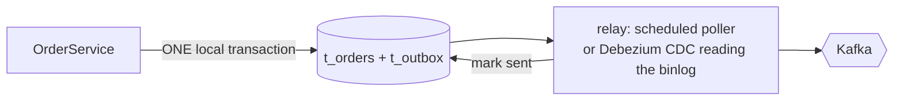

# 5. Data and transactions

## The idea in plain words

Each microservice **owns its data**: order-service has its own MySQL schema, inventory-service has another, product-service uses MongoDB. No service reads another service's tables; they talk through APIs and events. This is **database per service**. It lets each service change its schema and scale on its own, but it costs you **cross-service transactions**: you can no longer wrap "create order + reduce stock" in one ACID transaction.

## Where it lives

| File | What it does |
|---|---|
| [order db/migration](../../my-order-service/src/main/resources/db/migration/) · [inventory db/migration](../../my-inventory-service/src/main/resources/db/migration/) | Flyway migrations: versioned SQL scripts |
| [OrderService.java](../../my-order-service/src/main/java/com/sh_order/microservice/order/service/OrderService.java) | Transaction boundaries, and comments on the dual-write gap |
| [InventoryRepository.java](../../my-inventory-service/src/main/java/com/sh_inventory/microservice/inventoryservice/repository/InventoryRepository.java) | Derived queries + an atomic `@Modifying` update |
| [Product.java](../../my-product-service/src/main/java/com/sh_product/microservice/product/model/Product.java) | A MongoDB `@Document` |

## Flyway: schema as code

- Files named `V<version>__<description>.sql` run **once, in order**, on startup. Flyway records each one in `flyway_schema_history` along with a **checksum**.
- **Never edit a migration that has already run**: the checksum changes and Flyway refuses to start. Add `V3__...` instead.
- `spring.jpa.hibernate.ddl-auto=validate`: Hibernate only *checks* that the entities match the schema; Flyway is the only thing that changes it. (`update` lets Hibernate alter tables silently, with no history, no review and no rollback. Fine for a prototype, dangerous in production. That was [BLD-4](../AUDIT.md#4-build-code-quality-and-docs).)
- `baseline-on-migrate=true`: order-service's existing local DB had been created by Hibernate, so Flyway marks it as "already at V1" instead of failing.
- Example in inventory: `V1__init.sql` creates the table, `V2__add_inventory.sql` seeds the data.

## Transaction boundaries

`@Transactional` works through a **Spring proxy**: the proxy opens the transaction before the method and commits or rolls back after it. Consequences that interviewers love to ask about:
- **Self-invocation**: calling a `@Transactional` method from another method *in the same class* skips the proxy, so there's no transaction.
- By default it **rolls back on unchecked exceptions only** (`RuntimeException`, `Error`), not on checked ones.
- It only works on `public` methods of Spring beans.
- `readOnly = true` skips Hibernate dirty-checking and is a hint for read replicas.

**What we changed ([REL-5](../AUDIT.md#2-reliability-and-correctness)):** `OrderService` used to be `@Transactional` as a whole, so the **HTTP call to inventory ran inside the DB transaction**. That holds a pooled connection (HikariCP's default pool is 10) while waiting on the network: 10 slow inventory calls and order-service can't talk to its own database. A DB rollback can't undo a remote call anyway. **Rule: keep transactions short, and never do remote I/O inside them.**

Also `spring.jpa.open-in-view=false`: by default Spring keeps the Hibernate session open for the whole HTTP request (Open Session In View), which hides lazy-loading problems and holds connections longer.

## Lost updates and atomic operations

The old "add inventory" inserted a new row every time ([REL-9](../AUDIT.md#2-reliability-and-correctness)). The obvious fix, "load the row, add in Java, save", has a race:

```
T1 reads quantity=10       T2 reads quantity=10
T1 writes 10+5=15          T2 writes 10+3=13   ← T1's +5 is lost
```

Fixes, in order of preference:
1. **Atomic SQL** (used here): `UPDATE t_inventory SET quantity = quantity + :q WHERE sku_code = :sku`. The database does the read and the write in one step.
2. **Optimistic locking**: a `@Version` column; the losing write fails with `OptimisticLockException` and is retried.
3. **Pessimistic locking**: `SELECT ... FOR UPDATE` (`@Lock(PESSIMISTIC_WRITE)`). Simple, but it blocks other transactions.

## The dual-write problem

`OrderService` writes to **two systems**: MySQL (`save`) and Kafka (`send`). There's no transaction spanning both:

| Failure | Result |
|---|---|
| DB commit OK, then the app crashes before `send` | The order exists, **no event** → no email, ever |
| DB commit OK, Kafka down | Same (now at least **logged**, via the `whenComplete` callback) |
| Send first, then the DB commit fails | An **event for an order that doesn't exist** |

**Fix: the Transactional Outbox pattern** (next step in the [ROADMAP](../ROADMAP.md)):



Insert the order **and** an outbox row in the *same* DB transaction (atomic). A separate relay publishes outbox rows to Kafka and marks them sent. If the relay crashes, it re-sends, so delivery is at-least-once and consumers must be idempotent.

## Distributed transactions: the Saga pattern

Today order-service **checks** stock but never **reserves** it (check-then-act): two customers can buy the last unit. Reserving stock in inventory and creating the order in order-service is a business transaction across two databases. Two-phase commit (2PC/XA) is avoided in microservices (it's blocking, couples availability, and Kafka doesn't support it). Instead, a **saga** is a sequence of local transactions, each with a **compensating action**:

```
1. order-service:     create order (status=PENDING)          ← compensation: cancel order
2. inventory-service: reserve stock (atomic decrement)       ← compensation: release stock
3. payment-service:   charge                                  ← if this fails → run compensations 2, then 1
4. order-service:     status=CONFIRMED
```

- **Choreography**: each service reacts to events (`OrderCreated` → inventory reserves → `StockReserved` → ...). Simple, but the overall flow is hard to see.
- **Orchestration**: a central orchestrator (a state machine, or Temporal / Camunda) tells each service what to do. Easier to follow and monitor.

## Interview questions

1. **Why database per service? What do you lose?** Independent change and scaling, failure isolation, and the right DB for each job. You lose joins and ACID transactions across services, and you get eventual consistency and data duplication.
2. **How do you query data across services?** API composition (call both and join in memory), or CQRS: maintain a read model fed by events.
3. **What does Flyway do when a migration fails halfway?** On MySQL, DDL isn't transactional, so you can be left half-migrated and the history row is marked failed. Fix forward with a new migration (or `flyway repair` after cleaning up manually). That's why migrations should be small.
4. **`@Transactional` doesn't roll back. Why?** A checked exception, self-invocation, a non-public method, an exception caught inside, or a different transaction manager.
5. **Optimistic vs pessimistic locking?** Optimistic: no locks, detect conflicts with a version column; best when conflicts are rare. Pessimistic: lock rows up front; best when conflicts are frequent and retries are expensive.
6. **Explain the outbox pattern and why it's needed.** See above. Key words: atomic local transaction, relay/CDC, at-least-once, idempotent consumers.
7. **Saga: choreography vs orchestration?** See above. Mention compensating transactions, and that a saga gives **ACD without I** (no isolation), so you need semantic locks such as a PENDING status.
8. **"Two users buy the last iPhone at the same time. What happens in this project?"** Both stock checks say true and both orders succeed: overselling, because stock is never decremented. The fix is an atomic reservation (`UPDATE ... SET quantity = quantity - :q WHERE sku = :s AND quantity >= :q`; 0 rows updated means out of stock) as one saga step.
9. **MongoDB vs MySQL for products?** Documents fit catalogue items with varying attributes and can be read without joins. Use relational storage where you need constraints, transactions and joins (orders, stock).
