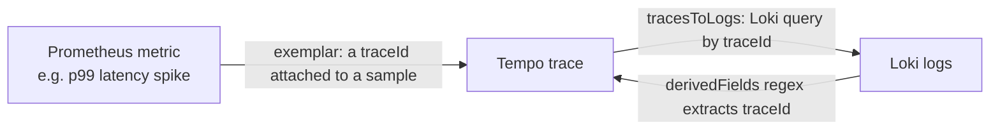

# 6. Observability: metrics, logs, traces

## The idea in plain words

With one application you can read its log file. With five services and a broker, a single user request touches many processes. **Observability** means you can answer *"what is happening, and why?"* from the outside, using three kinds of signal:

| Signal | Answers | Tool here | Model |
|---|---|---|---|
| **Metrics**: numbers over time | "Is something wrong? How bad?" (rates, error %, latency percentiles) | Micrometer → **Prometheus** | Prometheus **pulls** `/actuator/prometheus` every 2s |
| **Logs**: events with detail | "What exactly happened?" | Logback → **Loki** (loki4j appender) | The app **pushes** log lines |
| **Traces**: one request's path across services | "Where did the time go? Which service failed?" | Micrometer Tracing (Brave) → **Tempo** (Zipkin protocol, port 9411) | The app **pushes** spans |

**Grafana** shows all three, and the **links between them** are what make it useful.

## Where it lives

| File | What it does |
|---|---|
| `pom.xml` of each service | `actuator`, `micrometer-registry-prometheus`, `micrometer-tracing-bridge-brave`, `zipkin-reporter-brave`, `loki-logback-appender` |
| `logback-spring.xml` of each service | Sends logs to Loki with labels `application`, `host`, `level` |
| `management.*` / `logging.pattern.correlation` in each `application.properties` | Exposure, histogram buckets, sampling, the trace-id-in-logs format |
| [prometheus.yml](../../api-gateway/docker/prometheus/prometheus.yml) | Scrape targets |
| [datasources.yml](../../api-gateway/docker/grafana/datasources.yml) | Grafana data sources and the cross-links |
| [tempo.yml](../../api-gateway/docker/tempo/tempo.yml) | Tempo with a Zipkin receiver |

## How a trace is built

- A **trace** = one request end to end, with a 128-bit `traceId`. A **span** = one unit of work inside it (an HTTP call, a DB query, a Kafka send), with a `spanId` and a parent span.
- **Context propagation**: when order-service calls inventory, the auto-configured `RestClient.Builder` adds a W3C `traceparent` header (`00-<traceId>-<spanId>-01`). Inventory continues the same trace. That's why [RestClientConfig](../../my-order-service/src/main/java/com/sh_order/microservice/order/config/RestClientConfig.java) uses the injected builder and not `RestClient.builder()`.
- **Across Kafka**: the trace id travels in a record header (`spring.kafka.template.observation-enabled=true` on the producer, `spring.kafka.listener.observation-enabled=true` on the consumer).
- **Sampling**: `management.tracing.sampling.probability=1.0` traces every request. Fine locally; in production use something like 0.1, or tail-based sampling (keep all errors and slow requests).

## Correlation: jumping between signals



Every log line contains `[app,traceId,spanId]`, for example:
```
INFO --- [order-service] [nio-8081-exec-1] [order-service,6af8450328869a3c...,ea9ede2a6422efea] c.s.m.o.s.OrderService : Published OrderPlacedEvent for order ...
```
Grafana's Loki data source uses a regex to turn that trace id into a clickable link to Tempo. The old regex didn't match the Spring Boot 3.2+ format, so the link was broken ([OBS-3](../AUDIT.md#3-observability)).

## Metrics worth knowing

- **RED** for request-driven services: **R**ate, **E**rrors, **D**uration. Here that's `http_server_requests_seconds_count`, filtered by `status=~"5.."`, and `histogram_quantile(0.99, rate(http_server_requests_seconds_bucket[5m]))`.
- **USE** for resources: **U**tilisation, **S**aturation, **E**rrors (CPU, the Hikari pool, JVM memory).
- `percentiles-histogram.http.server.requests=true` publishes histogram buckets, so Prometheus can compute percentiles **across instances**. Client-side percentiles can't be aggregated.
- Resilience4j publishes circuit-breaker metrics (`resilience4j_circuitbreaker_state`), which are good to alert on.
- **Cardinality**: never put unbounded values (user id, order number) in metric tags; every distinct value creates a new time series.

## Mistakes we found

[OBS-1](../AUDIT.md#3-observability) Prometheus scraped itself instead of the gateway · [OBS-2](../AUDIT.md#3-observability) the gateway reported itself as product-service · [OBS-3](../AUDIT.md#3-observability) the log→trace link was broken · [OBS-4](../AUDIT.md#3-observability) a space in a service name · [OBS-5](../AUDIT.md#3-observability) traces stopped at Kafka · [SEC-6](../AUDIT.md#1-security) PII in logs.

## Interview questions

1. **Monitoring vs observability?** Monitoring checks known failure modes (dashboards, alerts on known metrics). Observability lets you investigate *unknown* problems by slicing the signals in new ways, which needs high-cardinality context such as traces and structured logs.
2. **Push vs pull metrics?** Prometheus pulls: it knows when a target is down, and targets don't need to know where Prometheus is. Push (e.g. the OTLP push gateway) suits short-lived jobs.
3. **What is a span? How does context propagate between services?** See above. Mention the W3C `traceparent` header and B3 (Zipkin's older format).
4. **How would you find why one request was slow?** Find the trace (from the error log's traceId, or an exemplar on the latency graph), look at the span waterfall to see which service or query took the time, then open that span's logs.
5. **What do you alert on?** Symptoms users feel (SLO burn rate on error rate and latency), not every cause. Too many alerts lead to alert fatigue.
6. **What is OpenTelemetry?** The vendor-neutral standard (APIs, SDKs, the OTLP protocol, the Collector) for all three signals. Micrometer can bridge to it (`micrometer-tracing-bridge-otel` + an OTLP exporter). Migrating this project from Brave/Zipkin to OTel/OTLP is a sensible next step; Tempo accepts OTLP too.
7. **Logging best practices?** Structured (JSON) logs, correlation ids, the right levels, **no PII or secrets**, no logging inside tight loops, centralised and retained according to policy.
